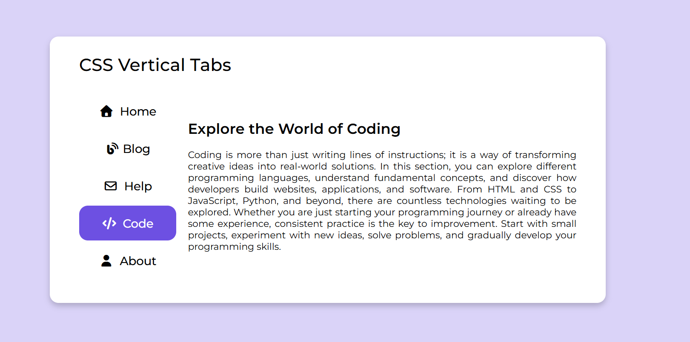
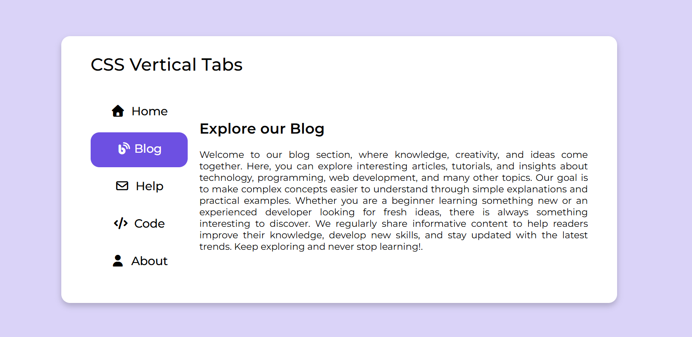
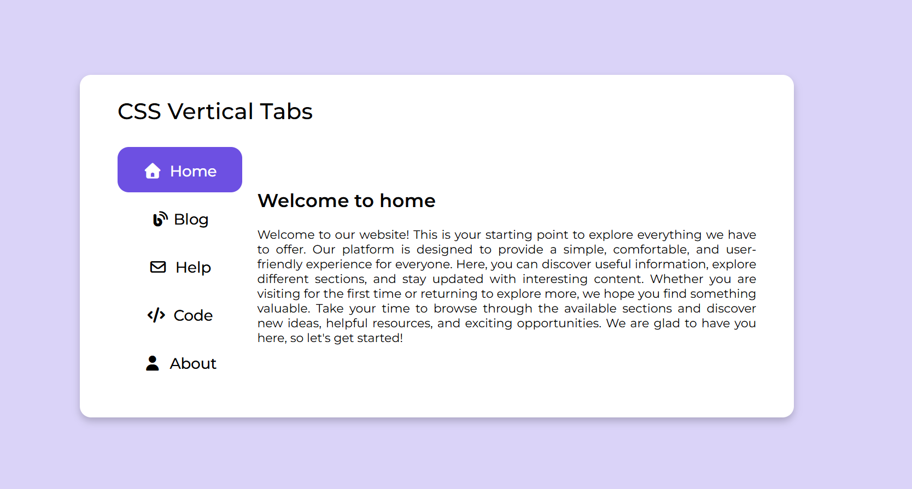

# CSS Vertical Tabs

A modern vertical tab navigation interface built using pure HTML and CSS. This project demonstrates how to create interactive tabs without using JavaScript.

## ✨ Features

- Vertical tab navigation layout
- Smooth animated indicator
- Interactive tab switching using radio buttons
- Dynamic content visibility using CSS selectors
- Font Awesome icons
- Google Fonts integration
- Clean UI with rounded corners and shadow effects
- Five different content sections

## 🛠️ Technologies Used

- HTML5
- CSS3
- Font Awesome
- Google Fonts

## 📂 Project Structure

```text
css-vertical-tabs/
│
├── index.html
├── style.css
├── images/
│   └── preview.png
└── README.md
```

## 📸 Preview





## ⚙️ How It Works

This project uses HTML radio buttons to control the active tab.

- Each radio button represents a tab.
- Labels are connected to radio buttons using the `for` attribute.
- The CSS general sibling selector (`~`) detects the checked radio button.
- The active tab receives a highlighted background through the animated indicator.
- Only the corresponding content section is displayed.

## 🚀 Getting Started

1. Clone this repository:

   ```bash
   git clone YOUR_REPOSITORY_URL
   ```

2. Open the project folder.

3. Open `index.html` in your browser.

## 🎯 Purpose

The purpose of this project is to practice CSS positioning, Flexbox, pseudo-classes, sibling selectors, transitions, and interactive UI design without JavaScript.

## 👨‍💻 Author
-MD JUNAID ARIFIN
Created as part of my HTML and CSS practice projects.